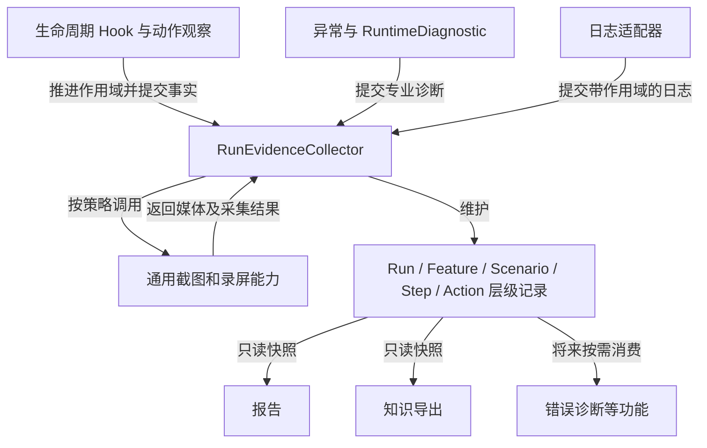

# 6. 统一运行证据采集实施方案
文档哈希（SHA256）：`4a988bdaa98b5ad83d22b1ee5b8642073c453e560b477f53d2f7e37c9ae00deb`

状态：第 10 节统一采集已完成本地验收；第 11 节 P6 首版已接入并使用模型替身验证，真实模型/桌面/产品门未验收。编制日期：2026-10-26。修订日期：2026-10-28。
本次按用户澄清重新聚焦：按框架生命周期统一现有证据采集，报告等模块直接消费。
旧文件名保留以免已有链接失效；AI 失败诊断只是后续消费示例，不是本次重构的主线或完成条件。
第 9 节保留首轮层级采集和同源消费记录；第 10 节补齐统一装配与日志管理的设计及实际实施记录。

本文保留原分阶段设计，并在第 9 节记录 2026-10-27 用户明确要求实施 P0～P5 后的实际结果。
前文中的目标接口以当前代码和第 9 节为准，不把本地替身验证等同于真实桌面验收。
后续继续工作仍须明确当前任务范围，核对最新代码和测试，不因本文存在而自动执行外部操作。
第 9 节不是全部管理目标的完成证明。第 10 节在明确实施请求后完成装配/日志收口，
不是重做 P0～P5，也不是接入 P6；具体已验收内容和剩余外部门见第 10.8 节。

## 1. 目标与产品结果

### 1.1 核心目标

当前框架已有采集能力，但运行事实分散在 Hook、Reporter、KnowledgeCapture、日志和媒体
组件中。本次建设一个运行级 `RunEvidenceCollector`，按以下层级组织同一次执行的证据：

```text
Run
  Feature
    Scenario / Example
      Step
        Action
```

采集器既不是原组件旁边的一份备份字典，也不是替换截图、录屏、OCR/PIC 等通用能力。
它拥有运行证据的层级、上下文、采集策略、关联、保存和查询；可以主动调用底层能力。
原组件中的重复采集职责要迁走，报告和知识导出只保留自己的投影、业务扩展与交付。
“统一”必须包含本次采集资源的统一装配、使用和收尾，不仅是统一 JSON 或保存对象引用。
底层能力保持独立实现，不意味着正常 BDD 还需分别初始化日志、录屏和采集出口。

### 1.2 用户和消费方看到什么

- 用户仍正常运行 Feature，无需额外 Job、服务或手工整理证据。
- 报告可直接读取完整运行或单个场景快照，展示状态、异常、截图、录屏、动作和相关日志。
- 知识导出读取同一执行事实，按已开启的知识策略取得详细值、来源快照和动作相位图。
- 关闭报告、知识导出或模型功能，采集器仍能记录基础执行信息。
- 未来诊断模块只需读取证据、组织 AnalysisRequest，不再另造采集流程。本方案不预定其
  同步/异步模式、独立页面或后台进程，亦不以这些功能证明采集器完成。

目标旅程：

```text
正常 runner 入口建立本次 Collector
  -> Hook 推进 Feature / Scenario / Step 上下文
  -> 动作观察入口记录 Action、目标、结果或异常
  -> Collector 按策略调用媒体能力并关联日志、诊断和附件
  -> 报告/知识模块按需读取只读观察快照
  -> runner 结束执行和剩余清理，补齐最终运行结果
  -> 交付统一记录；报告/知识消费者据其生成各自内容
```

### 1.3 完成标准

- 一次失败的步骤、异常、调试图、录屏和相关日志可通过明确身份关联，不靠目录扫描猜测。
- Run/Feature/Scenario/Step/Action 的执行记录只有一个 owner，不要求同一张图被不同需求重复采集。
- 任意一个消费者都能读取所需层级，不通过 Reporter 或 KnowledgeCapture 反查执行事实。
- 原业务结果、异常语义、标签、Step scope、部分执行来源和媒体策略不被重构改变。
- 新一轮运行不破坏已交付的历史证据；缺失、超限、采集失败都可见。
- 报告与知识功能消费同源数据且独立失败，不以 AI 请求成功作为重构验收。
- 正常 BDD 只通过一个采集会话入口装配资源；Collector 管理本次日志与媒体生命周期，
  Hook、RunState 工厂及消费者不再另行安装和关闭同一资源。本地证明见第 10.8 节。

## 2. 当前事实与迁移清单

下表保留最初编制时的采集分散基线和迁移目标，不表示这些旧行为目前仍全部存在。
层级/消费迁移见第 9 节，后续统一装配/日志收口见第 10 节；工程 AI 必须复查当前代码。

| 实施前 owner | 实施前行为 | 原迁移目标 |
| --- | --- | --- |
| [context_runtime](../../autowork_core/runtime/context_runtime.py) | 创建 RunState、ScreenRecorder、可选 Reporter，配置独立文本日志 | 将 runner 已创建的 Collector 接入 RunState，装配媒体能力和日志适配；不另建运行身份或模型连接 |
| [environment](../../autowork_core/runtime/environment.py) | 分别分发报告和知识 Hook；after_step 自行截图；收尾聚合清理异常 | 保持生命周期编排，提交事实；失败截图和证据录屏策略交 Collector |
| [SparkReporter](../../autowork_core/runtime/reporting/spark.py) | 自建执行层级、计时、异常详情、附件；扫描 OCR/PIC 新图 | 删除已迁移的事实采集，读取快照；保留报告投影、Outline 分组、统计和渲染 |
| [RuntimeDiagnostic](../../autowork_core/common/runtime_diagnostics.py) | 定位/等待/断言诊断结构、异常附加及最近诊断 ContextVar | 保留专业诊断生产和异常传递；Collector 在边界统一记录 |
| [log_helper](../../autowork_core/common/log_helper.py) | log_call 在 DEBUG 输出调用入口及参数 | 复用接入点补通用调用元数据，不把文本日志解析当结构化事实源；文件内说明的 log_return/log_error 不是已有实现 |
| [ScreenRecorder](../../autowork_core/utils/screenshot.py) | 通用截图、录屏、缓冲视频、文件管理 | 保留通用能力，通过运行专属实例由 Collector 编排 |
| [scenario_runtime](../../autowork_core/runtime/scenario_runtime.py) | 录屏启停保留、应用与进程管理、DEBUG 现场输出 | 仅迁移运行证据录屏策略；应用启动、RootStore、进程追踪和资源释放仍归原 owner |
| [OCR 引擎](../../autowork_core/common/ocr_engine.py)、[PIC 引擎](../../autowork_core/common/pic_engine.py) | 识别时抓图；失败时绘制并保存调试图 | 算法抓图和绘制能力保留；当前识别图及候选显式提交 Collector，由其编排诊断图落盘和登记 |
| [knowledge_observation](../../autowork_core/runtime/knowledge_observation.py) | 在知识采集开启时观察动作、解析参数、目标与前后窗口图 | 通用观察下沉为运行证据生产入口；知识专属采集需求由策略表达 |
| [KnowledgeCapture](../../autowork_core/runtime/knowledge_capture.py) | 另建运行层级、异常、动作、图像、来源快照及案例导出 | 通用事实改为消费统一记录；来源快照、案例身份、知识工件和导出要求保留 |
| [run_result_bridge](../../autowork_core/runtime/reporting/run_result_bridge.py) | 从报告投影结果、核验附件、保存 HTML 快照和 provenance | 保留公开发布契约与校验，不充当新的执行期采集器 |
| [behave_runner](../../autowork_core/runtime/behave_runner.py) | 按 clear_screenshots 清理公共截图、录屏和报告目录 | 在解析/预检前建立最小记录，运行出口确认最终结果并交付；新目录不被旧清理删除，原返回/异常语义不变 |
| [动作调试运行时](../../autowork_core/utils/debug_tools/action_runner_runtime.py) | 直接 create_run_state，主动关闭报告，不经过 Behave 生命周期 | 保持无采集器的轻量上下文，不默认创建 Run、生成报告或采集媒体；不继承外层 Collector |

这张表区分迁移策略和保留能力，并非要求删除所有现有类。尤其是 RuntimeDiagnostic、
RootStore、进程管理和 ScreenRecorder 的专业实现继续保留；迁走的是各处独立维护的证据和策略。

必须消除的具体断点：

1. OCR/PIC 图当前靠前缀、目录差集和修改时间关联，缺少可靠的步骤/动作归属。
2. Reporter 与 KnowledgeCapture 分别构建执行层级；通用事实和身份不能继续独立维护。
3. 场景清理异常在当前报告回调后抛出；必须记录真实清理异常及最终状态，不只收 step.exception。
4. 公共媒体目录可能被后续运行清空；只登记原路径不等于实现持久证据。
5. 日志级别控制显示，不应决定关键结构化事实是否存在；DEBUG 关闭不能丢失必要身份和异常。

## 3. 固定架构与所有权

### 3.1 依赖方向



- Collector 归运行时，不归 reporting、knowledge 或 LLM。核心采集不依赖消费模块。
- Reporter、知识模块读取 Collector 的查询接口或快照；不能回写执行事实或直接修改内部字典。
- Consumer 的过滤、分组和展示字典属于投影，不是新的采集；禁止消费者重新从 Behave、
  日志文件或媒体目录收集已迁移的信息。
- 知识动作迁移适配器只投影同一条记录，不启动第二次动作观察、截图或业务调用；它可以先于
  完整知识模块迁移上线，不能把适配与双写混为一谈。
- 未来报告错误诊断归 reporting；通用 [Analyzer](../../autowork_core/inference/analyzer.py)
  和 [LlmClient](../../autowork_core/integrations/llm/client.py) 是可复用能力，Collector 不依赖它们。
- 底层 OCR/PIC、媒体能力不能反向导入 Reporter 或完整 Collector 实现；通过可选调用参数或
  轻量上下文端口提交证据。脱离 BDD 的独立调用仍能工作，不隐式创建 Run。
- 不建立通用插件注册中心、网络消息总线、数据库或面向所有采集的继承体系。
  普通运行不因该重构增加后台任务平台、模型进程或新的远端依赖。

### 3.2 建议目录

以下均为目标位置；不是要求一次创建全部文件，也不是已经存在的入口。

```text
autowork_core/runtime/evidence/
  models.py          生命周期层级记录、诊断、附件和只读快照
  collector.py       当前作用域、采集策略和统一写入入口
  store.py           本运行产物保存和快照读写，按需要拆分
  context.py         供生产方使用的轻量作用域端口，按需要拆分
  logging.py         现有日志的单向接入，按需要拆分

autowork_core/runtime/reporting/spark.py  消费层级快照，生成报告
autowork_core/runtime/knowledge_capture.py  逐步改为知识需求与导出适配
```

只在真实职责出现时拆文件。首版不要求实现通用事件存储或事件回放；可以用一个层级模型、
必要的只读快照和有界日志记录起步。禁止为了目录完整创建空壳。

### 3.3 能力与策略的边界

| 项目 | 保留在能力或执行 owner | Collector 拥有 |
| --- | --- | --- |
| 截图 | mss 抓取、区域裁剪、图片编码 | 是否截图、原因、作用域、命名、保存和失败登记 |
| 录屏 | ffmpeg、启停、缓冲片段和合并实现 | 普通 BDD 场景的录屏策略、保留决策和证据归属 |
| OCR/PIC | 算法输入、识别、候选、绘制方法 | 诊断图是否保存、关联、完整性与保留 |
| 异常 | 原异常产生、抛出、原因链和断言判断 | 结构化记录、发生阶段、专业诊断关联、采集异常分离 |
| 执行 | Behave 状态、标签、应用和进程生命周期 | 只观察结果；不能把 False/None 返回值擅自改判为测试失败 |
| 日志 | Loguru 调用与终端/文件输出能力 | 本次出口装配/关闭、归档路径、阶段、执行身份、受控字段和顺序 |

本次采集会话的入口、资源装配/关闭、文件日志归档也属于 Collector 主权；不能只把结构化
日志接入 Collector，却让正常运行继续由外部维护另一套公共文件日志。具体后续改动见第 10 节。

Collector 能主动调用能力，但只控制本次运行拥有的实例。不能停止或删除其他运行、
Recorder 工作台、手动录屏或工具窗口的媒体。

### 3.4 硬边界

- Recorder CaptureRuntime、Workbench、Generation Job、原始证据、PIC 和授权协议不在本轮迁移范围。
- 不修改 Request、Decision、Plan、Transaction、lease、provenance 或 Plan-to-Code 安全门。
- 当前架构宪法明确 scenario_runtime 拥有录屏编排；该职责迁移是本方案提出的目标变更，
  不是当前事实。P2 实际迁移并验证后，才同步相应架构文档，不预先改写成已生效。
- 不因知识案例或报告内容相似而合并来源；身份、实际执行和采集时点必须保留。
- 不调整产品 Page、业务 Step、应用选择、locator 或真实设备配置来通过框架测试。
- 不把现有 Run Result 的场景聚合状态改成 runner 退出状态；二者口径在第 4.3 节单独定义。

### 3.5 普通执行与轻量调试的装配边界

同一个 RunState 工厂会被正常 BDD 与动作调试入口调用，不能假定调用它就一定正在执行 Feature。

- 目标接口为显式可选注入，例如 create_run_state(collector=None)；默认不创建 Collector，
  不读取当前全局作用域来偷偷继承 Collector，也不为满足字段要求构造一个新 Run。
- 正常 environment.before_all 取得 runner 已创建的本次实例，显式传给工厂；该实例和
  execution_id 不在 RunState 工厂内重建。
- 第 10 节收口后，工厂仅引用该实例已装配的媒体能力；正常 BDD 不再由工厂创建后反向挂接，
  不再由 Hook 分别安装文本日志和结构化 sink。无 Collector 的独立模式保留自己的装配行为。
- 轻量动作调试继续调用无 Collector 的工厂、保持 reporter=None。生产端口在未注入时直接
  执行动作，不采集、不持久化、不触发截图/录屏或模型；保留原动作诊断和显式调试能力。
- 无 Collector 是正常的非采集模式；Collector 故障后禁用是带 evidence_unavailable 的降级模式，
  二者不能都显示成“采集成功但没有记录”。
- 谁创建谁关闭。轻量调试清理自己的 recorder/indicator，不关闭外层运行的 Collector、媒体或 sink。
  若未来要为动作调试提供采集，作为独立的显式功能设计，不纳入普通 BDD 的隐式默认行为。

这里不增加模式注册器或另一套 RunState；仅在现有工厂和调用方之间确定清楚的注入契约。

## 4. 数据与生命周期契约

### 4.1 生命周期模型与身份

| 节点 | 记录内容 | 数据来源与归属 |
| --- | --- | --- |
| Run | 本次选择、Feature 集合、运行期异常、采集完整性及 runner 最终结果 | runner 建立身份，Hook/执行出口补齐；Collector 管理 |
| Feature | 源文件、标签、声明/选择的执行单元、实际 Scenario 和规则来源 | Feature Hook 提供；Rule 作为来源元数据保留，不改变报告层级 |
| Scenario / Example | 本次执行实例、Outline/行参数来源、Step 集合、初始化和清理异常、场景录屏 | Scenario Hook 提供；每个 Example 是独立执行实例 |
| Step | 规格类型、名称、源行、执行状态、Action、异常诊断、失败截图和相关日志 | Step Hook 提供；Background 的声明来源与实际执行实例分别记录 |
| Action | 操作、Page/View/目标、返回类别、异常、起止和可选相位图 | 复用现有动作观察边界；不把每次内部 helper 调用都创建成动作 |

各节点均可关联日志、异常和附件。初始化、清理或全局错误没有 Step 时，挂在实际 Run/Scenario
节点，不伪造一个业务步骤。未执行的声明只保存 planned/skipped 信息，不伪造 Action。
嵌套 execute_steps 和动作调用保存父引用；作用域通过栈恢复，当前节点不是单个可覆盖的全局变量。

- `execution_id`：在执行入口建立的运行身份；在媒体目录准备前确定，每次真实执行独立生成。
- `feature_id/scenario_id/step_id/action_id`：运行内实例身份，带源文件、规格行、Example、
  部分执行来源和父子关系；名称仅为展示。嵌套 execute_steps 使用作用域栈和 parent_step_id。
- `run_result_id`：现有发布器根据交付内容计算的结果身份；不能用 execution_id 替代或伪造。
  初期通过独立关联 manifest 记录二者映射，不擅自扩展现有 Run Result 协议字段。

UUID、哈希和摘要只提供唯一性/一致性，不证明业务正确，也不提供签名意义上的可信来源。

### 4.2 最小记录

| 记录 | 必须表达 |
| --- | --- |
| 运行与规格 | 身份、来源、选择范围、声明单元、环境白名单、起止和最终执行状态 |
| 生命周期记录 | 顺序号、UTC 时间、单调时钟耗时、作用域、类型、阶段和产生组件；不要求事件回放系统 |
| 步骤结果 | rawStatus 与现有规范状态、执行/未执行、异常引用、步骤顺序 |
| 专业诊断 | 现有 RuntimeDiagnostic 及其版本；缺失不能补造 |
| 异常记录 | 安全序列化后的类型、消息、堆栈、cause/context、ExceptionGroup 子异常及原阶段 |
| 动作结果 | 原操作、目标摘要、开始结束、实际返回类别；不把 returned_false 等同失败 |
| 附件 | artifact_id、所属作用域、角色、相位、实际区域、来源记录、路径、大小和 SHA256 |
| 采集结果 | captured/missing/failed/not_requested/discarded、原因及缺失范围 |
| 采集完整性 | 丢弃计数、超限原因、写入失败、缺图、未完成记录；与测试状态分开 |

附件指纹只在文件最终完成后确定；不能给仍在写入的视频计算“最终摘要”。
记录大小、文本长度、事件数、图像数量和输出目录总量必须有明确限制。
超限时不能静默丢失关键异常或伪装完整；保留身份、最终状态、缺失计数和可用的最小异常记录。
不把异常对象、控件包装器、完整 Context 或可执行对象直接持久化。

### 4.3 存储、快照与结果口径

内存层级模型由 Collector 独占写入，消费方取得独立只读快照。
首版以运行隔离目录保存检查点和最终快照，不要求把所有读取建立在 events.jsonl 重放上：

```text
artifacts/runtime-evidence/<execution-id>/
  run.json             层级运行快照；明确 observed/finalized/incomplete
  assets/              本运行生成或接管的完整媒体
  logs/                运行文本日志；执行/交付分离，具体归档见第 10 节
```

结构化日志沿用 run.json.logs；可选 logs.jsonl 不是完成门，也不另建一份执行事实源。

- 单运行使用一个统一写入入口分配身份和顺序；不同运行独立。子线程必须显式传播关联身份，
  不假定 ContextVar 自动覆盖所有线程或进程。禁止通过时间排序恢复缺失的因果归属。
- 热路径更新相应节点并追加必要日志；在场景收尾等有界检查点和运行结束原子保存快照，
  不在每次动作后重写整份大文档。耗时截图、哈希和消费操作不得持有记录锁。
- 不同深度的读取来自同一层级模型，不能由消费者另读 Behave 拼一套事实。Collector 在
  生命周期边界及最终核对时读取执行状态，属于统一采集，不属于重复来源。
- 中断后能恢复到最近有效检查点即可；未封存记录标为 incomplete，不承诺恢复尚未落盘的尾部。
  不自动重跑或续写旧执行。若以后确实需要逐事件恢复，再单独设计事件日志。
- 场景收尾和 after_all 中只提供 observed 快照，不承诺 runner 已成功结束。
  Behave 在 after_all 之后仍执行剩余 Context 清理并计算结果；只有该执行返回或抛出后，
  runner 的统一出口才能补齐最终结果并最终封存；此前快照必须显示其观察阶段。
- 最终封存之后，报告和 AI 结果只能写派生工件，不能把模型推断回写成执行事实。
- 封存完成后，采集 sink 停止向这份执行记录写入。报告/知识导出的普通日志继续输出，
  但不能追加到已封存的 logs.jsonl 或重开 run.json；交付结果通过第 4.8 节的独立结果表达。
- 原始文件不自动删除；只设计明确的整 Run 保留/清理入口，不在启动时清理其他运行。
- 运行交付记录使用最小来源关联，媒体引用附 execution_id 与 artifact_id；自包含交付可复制
  并核验媒体。首版不引入引用计数平台或后台垃圾回收，不因一个消费者完成就删除共享原件。
- 日志、报告和知识工件可以保存各自投影或交付快照。它们不是重复采集，但不能由消费方
  修改原始记录，也不能把派生摘要当成原始时点证据。

  必须区分三种结果：

  1. Scenario/Step 的 rawStatus 与规范状态：继续记录 Behave 实际结果，保持现有统计口径。
  2. `runner_outcome`：Collector 的 Run 级结果，来自对应执行入口的实际返回、异常和可取得的
    Hook/清理信息。Runner 的 failed 布尔返回与 CLI 的退出码含义不同，必须按入口明确适配；
    未取得的信息标记 unknown/unavailable，不能从全部场景通过推断运行成功。
  3. 现有 Run Result `status`：仍按执行单元聚合，保持发布版本、指纹和 provenance 校验。
    本方案不把它偷换成 runner_outcome；二者通过 execution_id 与发布结果引用关联。

  例如场景全部 passed、但最终 Context 清理失败：报告显示“场景全部通过；运行收尾失败”，
  Collector 保存 runner_outcome=failed，Run Result 仍保持既有执行单元口径。
  如未来要让 Run Result 同时承载整体运行结果，必须另行明确协议变更，不能在本重构中隐式改语义。

### 4.4 最小公共接口

以下为语义契约，不要求照抄为固定方法数量：

```text
begin_run / begin_feature / begin_scenario / begin_step
record_step_result / record_exception / record_diagnostic
capture_failure / register_artifact
begin_action / finish_action / record_log
finish_scenario / finalize_run
snapshot_run / snapshot_feature / snapshot_scenario / snapshot_step
close
```

- `capture_failure` 根据策略主动调用能力；`register_artifact` 接收已经产生的真实附件。
- 实现可采用 snapshot(scope) 这一统一查询，不必为每一层另建一个服务类。snapshot 中包含
  子节点及其日志、诊断和附件；选择依据是节点身份，不是文件名或“最新场景”。
- 生产入口只接收当前发生的事实；报告和知识模块只读，不通过 begin/record 接口回填显示数据。
- 对同一失败的重复回调必须幂等，不能重复截图；同一异常的多处引用保留关联而非重复序列化。
- 不因图片相似或处于同一窗口而替换动作时点；OCR/PIC 使用识别时实际图像和候选，不重新抓图冒充。
- snapshot 为只读/独立副本；消费方修改不能影响 Collector。禁止公开可变 document 字典。

典型配合过程：

```text
Step Hook: begin_step
动作观察: begin_action -> 执行动作一次 -> finish_action 或 record_exception
Step Hook: record_step_result
Collector: 按失败策略调用截图能力 -> 保存文件 -> 关联到本 Step
Scenario Hook: 完成录屏与清理记录 -> finish_scenario
Reporter: snapshot_scenario -> 生成场景详情，不再次抓图或读取 exception 对象
```

### 4.5 Hook 顺序与异常保证

1. 在项目管理的 FeatureScopedRunner 公共执行入口、加载 Hook/解析 Feature/预检之前，
  建立 execution_id 和最小 Collector。run_behave 与直接 Behave 入口复用同一作用域，不能各建一次。
  必须在现有 settings_overrides 生效后读取设置；原参数、Step scope 和来源控制保持不变。
2. 第 10 节收口后，同一 runner 作用域调用 Collector.start，统一准备本次日志与媒体能力。
  before_all 将已经启动的实例接入 RunState，只引用其能力和上下文；Reporter/知识模块提供消费需求，
  不能重新生成身份或重新初始化记录。构造 RunState 失败也由外层最小记录承接。
3. 每个 Hook 先建立正确作用域，再执行原工作；步骤结果和原异常在截图前登记。
4. after_scenario 先停止本运行录屏，再执行原清理链，逐项登记清理结果并保留原异常。
   不因为首个清理失败而跳过必要资源释放；单异常/ExceptionGroup 的原语义不改变。
5. after_all 只记录当前已观察状态、形成观察快照并完成原必要资源清理；不调用模型，
  不把此时快照作为最终封存。媒体释放不能同时销毁仍需接收晚到清理信息的最小记录。
6. runner 在 Behave 执行和剩余清理完成后的统一出口补齐 runner_outcome、最终封存，
  再按第 4.8 节单次调度报告/知识收尾。runner 只协调生命周期，不生成报告、不导入模型，
  也不建立通用消费者注册系统。Run Result 口径依第 4.3 节保持；消费错误按第 4.6 节隔离。
7. 项目入口内的 Hook 加载、解析和预检失败仍尽力保留 incomplete 的最小记录，原异常继续抛出。
  Python 无法启动、项目入口导入前、外部 CLI 参数解析失败不在此保证范围，不能声称已全覆盖。
8. 外层 finally 关闭本运行媒体、日志和记录资源；重复清理须幂等。内层清理异常已经处理时，
  外层释放不能覆盖原异常或改变 Behave 返回值，也不能启动替代 Run 来补证据。

采集失败不能遮蔽原测试异常，也不能把执行失败改为 passed。证据缺失单独暴露。
涉及已有安全校验的失败仍沿原路径失败关闭；不能以“采集非阻塞”为理由吞掉执行校验异常。

### 4.6 采集与消费故障的降级契约

必须先在 P1 实现并测试以下分级，不能把日志里一句“采集失败”当作完整降级设计：

| 故障 | 要求的处理 | 对原执行的影响 |
| --- | --- | --- |
| 目录创建或快照写盘失败 | 同一有界内存记录继续更新，标记 persistence_failed，报告可消费内存快照；通过独立出口提示无法持久化 | 不替换原返回值/异常；不能宣称历史可恢复 |
| 单条数据序列化失败或超限 | 保留身份、事件类别、丢弃计数和安全摘要；标记缺失，不原样持久化对象 | 原业务动作只调用一次，返回值和异常不变 |
| 截图、视频、哈希或附件登记失败 | 记录媒体缺失与原因，继续必要清理 | 不覆盖原步骤异常，不扩大截图范围 |
| Collector 核心不可恢复 | 使用不采集媒体的禁用端口并输出一次应急诊断；报告明确 evidence_unavailable，不能显示完整采集 | 采集辅助错误不变成新的 Hook 失败；不因此放过执行安全门 |
| 报告或知识投影失败 | 保留已经封存的证据，显式提示消费失败；禁止回写测试状态 | 执行结果不受消费失败影响 |

内存记录是正常模型而非额外后备采集器；写盘失败只改变持久化能力。核心不可用时的禁用端口
不另存一套事实，也不退回旧 Reporter/KnowledgeCapture 重新抓取。持久化恢复时只保存该执行的
已有快照，不重放业务动作；不保证磁盘完全不可用时仍可落盘。
采集器核心不捕获 KeyboardInterrupt/SystemExit 来伪装继续成功，所有原控制流都必须保持。
应急出口不得再次进入采集 sink。按实际接管的阶段验证初始化、磁盘满、序列化、截图、封存和
清理失败；基础异常保护必须先于移除原隔离路径落地，不要求为此建立独立故障恢复平台。

### 4.7 数据分级与不可逆裁剪

| 数据层 | 默认范围 | 允许的消费 |
| --- | --- | --- |
| 基础运行证据 | 身份、状态、必要异常/诊断和受控元数据，不保存完整输入 | 基础报告、无详细采集时的降级诊断 |
| 显式开启的详细证据 | 按知识/详细策略允许的实际值、来源快照、目标信息和相位图 | 对应授权范围内的本地知识和诊断；有独立敏感/保留策略 |
| 消费投影 | 从已有证据生成的展示、摘要、截断片段 | 报告和知识格式，不得冒充完整原始材料 |
| 模型外发材料 | 再次按发送白名单脱敏、裁剪的文字与图片 | 仅发送给明确选择的模型，记录材料摘要和缺失说明 |

不能先在唯一事实源统一截断所有参数，再要求 P4 无损恢复知识案例。P0 应明确基础字段与现有知识
策略所需的详细字段；P3 在详细策略开启时保留这些字段的现有语义，模型预算裁剪只作用于派生输入。
隐私禁止记录或预算导致的原始缺失必须标记 restricted/truncated，知识消费不得继续宣称内容等价或完整。
旧历史证据不重新脱敏改写。若需改变现有知识采集内容或身份契约，必须单独明确范围，不归本次兼容迁移。

### 4.8 收尾调度迁移：先移动调用时机，再迁移知识实现

P1 必须完整替换正常 BDD 的收尾调度，不能保留 after_all 一次导出、runner 出口再导出一次。
当前固定运行收尾函数为 context_runtime.finish_run_state，不建立额外的消费者注册平台。
它属于现有运行状态装配边界，显式调用已有报告/知识入口，不引入通用任务或消费者注册平台。

| 时机 | P1～P3 过渡行为 | P4 完成后的行为 |
| --- | --- | --- |
| before_all 至 after_scenario | Collector 接收已迁移事实；知识模块暂按已声明边界保留尚未迁移的记录 | Collector 是通用运行事实的唯一 owner，知识模块只提供采集需求/投影 |
| environment.after_all | 只提交当前观察和完成必要资源清理；移除原报告最终生成和知识 finish/export 调用 | 同左，不在该 Hook 内最终交付 |
| runner 的统一出口 | 确认 runner_outcome，生成不可变最终快照，停止运行证据写入；固定收尾函数分别调用报告和知识完成入口 | 同左，知识完成入口改为从统一快照形成知识工件 |
| 知识完成入口 | 保留已有内容、case_id 分配和格式语义；刷新未迁移记录并调用 finish/export 一次 | 读取 Collector 快照，保留知识专属字段、身份和导出规则 |
| 入口失败、无 RunState | 仍尽力保存 runner 的最小记录；不虚构 Reporter/KnowledgeCapture，不伪造可消费的完整场景 | 同左 |

单次调度约束：

- 同一 execution_id 的最终封存和每个完成入口只调度一次；父子 runner 路径通过同一个外层
  作用域判断是否拥有收尾，不得在 run_model、run_with_paths、run_behave 各做一次。
- 各消费入口独立执行：报告失败仍可导出知识，知识失败不能覆盖基础报告。以 finally 保证清理，
  但不在 finally 中重复调用已开始或已失败的消费者，不做隐式重试。
- 用运行内简单状态记录 not_requested/not_started/started/completed/failed，防止重复调度并
  提示部分交付；这不是持久化任务状态机。需要保存交付摘要时放在派生产物旁，不回写封存快照。
- P1 报告已消费 Collector；P1～P3 知识仍有未迁移字段时，完成入口只刷新这些既有记录，
  不重新执行动作、截图或构建另一套通用采集。P3 的动作投影按原阶段要求同时接入。
- 知识工件的 test_status/capture_case_id 沿用已核实的既有含义，不把 runner_outcome 隐式
  替换进旧字段；通过来源关联保留整体运行信息。知识字段或身份语义若确需改变，单独确认。
- Collector 封存失败时，报告可以消费标记不完整的内存快照；Collector 核心不可用时展示
  evidence_unavailable，而不是回退到从 Behave 重采。原 runner 返回值和异常始终优先保留。

P0/P1 通过调用计数和故障注入证明：全部通过、场景失败、before_all 部分初始化失败、
after_all 失败、剩余清理失败及某个消费者失败时，不发生双导出、case_id 重新分配或清理二次执行。

### 4.9 报告投影与用户可见呈现

Collector 提供统一结构，Reporter 负责投影和呈现。迁移不能止于“JSON 有字段”，也不能为了
展示新的运行异常伪造失败 Step 或改变原通过率。

以下是目标字段语义，P0 确认命名后再实现；不是给现有 Run Result 增加字段：

| 报告信息 | Collector 来源 | 展示位置与行为 | 阶段 |
| --- | --- | --- | --- |
| 执行身份和运行结果摘要 | Run.execution_id、runner_outcome 及观察阶段 | 报告顶部紧凑运行摘要，与场景通过率分开 | P1 |
| 运行期/收尾异常 | Run 级异常及发生阶段 | 独立的运行问题区域，不挂到最后一个 Step | P1 |
| 证据完整性 | 采集状态、缺失范围、持久化失败 | 摘要中显示 incomplete/unavailable，详情可查看缺失原因 | P1 |
| 场景初始化/清理异常 | Scenario 级异常 | 对应场景详情，原步骤统计不变 | P1 |
| 截图/录屏/调试附件 | 对应节点的 artifact 引用 | 沿用现有附件入口，展示真实来源和采集状态 | P1/P2 |
| 动作与返回类别 | Step.actions 和各 Action 记录 | Step 下的动作详情，按需展开；返回 False/None 不自动染成测试失败 | P3 |
| 关联日志 | 当前节点及子节点的受控日志 | 场景或 Step 详情按范围展开，保留节点引用与截断说明 | P3 |

运行级摘要可以使用 executionSummary 等独立字段；场景异常使用 lifecycleErrors 等投影，
不能覆盖既有 Step.error/errorDetail。模板对旧报告缺少新增字段时保持可读。
Action 未接入/策略未开启与“记录到零个动作”要能区分；日志未采集与“没有异常日志”也不能混淆。
模型、日志和业务文本均按不可信内容转义，现有 script-safe JSON 和 HTML 转义不能退化。

合并报告的边界：

- 单次报告的 runner_outcome 仅属于该 execution_id。最终报告可能混合多次运行，不能将
  初始报告或最新源报告的运行结果当作整份合并报告的整体结论。
- final_report 的场景替换带上该场景的来源和生命周期异常；根部运行摘要仅在所有可见结果
  能证明来自同一次执行时展示单次结果，否则显示“多来源/不适用”，不推断整次 runner 成功。
- 纯 render 保持读取已有 JSON 的语义，不查询 Collector、不重新采集或导入外部内容。
  合并时处理来源与附件，渲染时只展示既有数据，Run Result 仍保持原发布和聚合契约。
- P1 必须覆盖“场景全部 passed、运行收尾失败”和“报告含多个 execution_id”两个实际展示案例。
  P3 再覆盖动作、日志、缺失/截断和旧报告的显示兼容，不重做整套报告导航和视觉设计。

## 5. 日志、配置与隐私

### 5.1 日志只走一个方向

```text
现有业务 logger 调用
  -> Collector 管理的单向日志适配：身份、阶段、受控字段和脱敏
  -> 执行期：写结构化运行记录，并输出本 Run 的执行文本及终端日志
  -> 封存后：只输出本 Run 的交付文本及终端日志，不再写执行事实
```

该目标已按第 10 节实施。第 9 节的公共文本日志加结构化 sink 是首轮历史状态，不能当作现状。
业务调用方式与 Loguru 能力不变；运行文件出口的装配、归档和关闭归 Collector。
正常 BDD 不再由 environment 调用独立公共日志配置；独立工具仍可显式使用自己的日志出口。

结构化生命周期和异常直接写 Collector，不解析自己的文本日志恢复事实。
sink 内不能再调用会进入同一 sink 的 logger；采集器自身故障走独立应急输出，带防重入保护。
上下文必须在 scope 退出时复原；关闭 Collector 只移除它创建的 sink，不影响其他日志会话。
启动前或无运行上下文的日志保留原输出，不猜测归到“最近场景”。

log_call 不是 action 边界：内部嵌套 helper 会反复调用它。因此它只补入口元数据，
完整动作起止和结果应复用 Page 观察边界；不能两处各创建一个 action。

### 5.2 配置原则

- 沿现有项目 YAML -> Settings -> settings_overrides，不能另造环境变量或配置加载器。
- 运行身份、结果和异常的最小证据记录不依赖报告/知识/AI 开关；详细动作、值和图像单独受控。
- 保持 RECORD_SETTING、OCR_SETTING、PIC_SETTING 和 KNOWLEDGE_CAPTURE_SETTING 的现有行为。
  重构不顺手修正已有录屏模式语义；如发现既有行为与注释冲突，另列问题并确认。
- 在 P0 确定采集预算及可选的新分组字段；不为了阶段推进重复更名公开配置。
- AI 连接继续使用 LLM_SETTING；配置存在不等于启用任何模型消费功能。

### 5.3 隐私边界

- 设置、公共数据、密码输入、Example 值、窗口标题、控件文本和日志都可能敏感。
  依第 4.7 节分级使用字段白名单和显式脱敏，不复制整个 settings.raw、locals 或 Context。
  日志脱敏发生在相关原终端/文件输出之前，不能只清洗 Collector 副本而让原 sink 泄漏同一内容。
- 本地证据与外发材料是两个边界；有本地图片不代表可以发模型或上传知识库。
- 未能安全确定归属/范围的媒体标记缺失，不能扩大到整个桌面后宣称等价。
- 不承诺通用脱敏能识别所有截图秘密。外发必须明确范围并保留发送材料摘要及缺失说明。

## 6. 主线实施阶段与可选消费示例

P0～P5 是统一采集器的实施主线。P6 是主线之外的可选应用，不能反过来扩大采集器职责。
设计修订将原 P5 的 AI 试点移到可选 P6，将统一采集收口置于 P5；实际实施状态见第 9 节。

```text
P0 数据模型与现状基线
  -> P1 生命周期、基础证据、报告首条消费链
  -> P2 异常诊断与媒体能力统一接入
  -> P3 Action 和日志统一接入，并提供知识动作投影
  -> P4 知识等现有消费者完成迁移
  -> P5 旧采集职责清退与正常旅程验收

P6 可选错误诊断：只消费已具备的证据，可在相应主线阶段通过后另行实施
```

P6 的文本和普通失败截图可在 P1 后试验；OCR/PIC、动作和关联日志分别依赖 P2/P3。
缺少的证据明确标记缺失，不绕回旧目录重新采集。P5 不依赖 P6，不要求真实模型请求成功。
同一文件和 owner 的修改串行整合；每阶段可拆小切片，但不能交付损坏现有消费者的中间版本。

### P0：生命周期数据模型和现状基线

目标：先回答每条信息属于哪个生命周期节点、由谁产生、谁在消费，再确定最小接口。

- 输入：上表 owner、现有报告、生命周期、视觉采集、知识采集测试。
- 范围：新增一份临时夹具或复用现有 fixture，确定身份、状态、附件、异常和预算契约。
  确认运行目录与旧清理路径隔离，定义新旧输出对照的规范化字段；明确第 4.7 节详细字段和发送策略。
- 交付字段映射表：现有 Reporter/KnowledgeCapture/日志/媒体字段 -> 统一节点 -> 生产入口 ->
  消费投影 -> 迁移阶段。把 planned、实际执行和未覆盖的动作区分清楚，不按日志反推层级。
- 基线必须覆盖：普通场景、同名场景、Outline 多行、Background、嵌套步骤、部分复跑、
  Feature/Scenario skip、初始化失败、步骤失败、多个清理异常、无 UI 的 API 场景。
- 增补正常 BDD 和直接 create_run_state 的动作调试两种入口；调试模式不自动创建采集 Run。
- 增补 runner 入口后解析/预检失败、before_all 失败、after_all 自身失败和剩余 Context 清理失败；
  明确每种情形何时可知最终结果。场景全部通过但收尾失败时，分别验证 runner_outcome 与
  现有 Run Result 聚合状态，而不是强行将二者改为相同。
- 交付：当前行为基线、失败复现、接口最小定义、后续阶段具体文件范围与测试命令。
- 收尾入口对照表、每个完成入口的调用计数基线，以及第 4.9 节对应的报告展示样例也是交付内容。
- 删除旧职责：无。本阶段不改执行路径，不改配置、公开协议和真实工件。
- 验收：能指出哪些字段是执行事实、派生展示、可选观察和缺失状态；每个差异有明确比较办法。
- 停止条件：无法核实原状态/录屏语义，或新身份必须改 Recorder provenance 才能工作，先返回具体问题。

### P1：生命周期层级与报告首条消费链

目标：交付第一条真实垂直链，不只新增未被使用的 Collector。

- 范围：拟新增 runtime/evidence 最小实现；修改 context_runtime、environment、SparkReporter、
  Spark 模板及 final_report 中与新增来源摘要直接相关的兼容投影；
  runner 负责最小运行作用域与执行出口；ScreenRecorder 仅按需要增加实例级输出路径能力，
  不修改全局 Paths。不动 OCR/PIC 算法、知识图文内容和 AI。
- 按第 3.5 节显式注入 Collector；轻量动作调试不受影响。必要时在该调试入口增加最小注入/
  资源所有权适配，不扩大为调试功能重构，不启用新的证据采集行为。
- 实现：建立 Run/Feature/Scenario/Step 层级及未来 Action 容器；维护声明和实际执行、
  部分来源、计时、原异常及已有 RuntimeDiagnostic。Action 观察未接入时明确 coverage，不伪造记录。
- Collector 主动调用原失败截图能力，直接保存到本运行隔离目录并登记；报告使用正确相对路径。
  普通失败图的生命周期保护不能推迟到 P2，不能先登记公共路径再要求消费方事后自救。
- 分开观察快照与 runner 最终结果；以同一内存层级模型生成只读快照、检查点与最终 run.json，
  不先实现完整事件存储。落实本切片的异常保护、持久化失败和禁用端口行为。
- Reporter 改为消费这一快照。Outline 聚合、跳过统计、原报告导航和发布器保持现有语义，
  模板仅按第 4.9 节扩展必要信息，不将新增展示误解为改变统计或重做页面。
  原 report Hook 可暂留为薄投影入口，但不能继续从 Behave 独立采集同样字段。
- P1 同时按第 4.8 节移交报告和知识完成入口的调度，删去原 after_all 的最终生成/导出调用。
  这是时机和单次执行迁移，不提前改写知识内容；P4 再迁移知识内部层级与导出实现。
- 按第 4.9 节在模板增加紧凑运行摘要、运行/场景生命周期异常和采集完整性展示，保持原统计。
  final_report 显式区分单次与多来源摘要，不能原样继承某次运行结果误导用户。
- 删除旧职责：Hook 的失败截图策略；Reporter 的独立生命周期字典、异常提取和相同字段的计时采集。
  尚未迁移的 OCR/PIC 和知识记录必须标明临时边界，不伪称已完成统一。
- 验收：P0 场景输出语义等价；截图仅一次且失败不遮蔽原异常；清理异常可见；
  报告关闭仍有最小记录；不同 Example 不串图；嵌套步骤结束能恢复父作用域；
  after_all/剩余清理失败不会记为整体运行成功；Run Result 统计口径不变；
  第二次运行不删除第一次运行的失败图；解析/预检失败有最小记录；故障注入不改变原控制流。
- 报告生成和知识 finish/export 分别只执行一次；报告失败仍可导出知识；原 case_id 分配不重复。
  调试入口无 Collector 仍可执行和清理，不隐式写运行证据或报告；Run 级问题在实际 HTML 可见。
- 聚焦检查：扩展现有 run_result_bridge、application_lifecycle、single_step_scope 测试；
  加入 action_runner_runtime、knowledge_capture、final_report_merge 的收尾/兼容相关用例；
  为 Collector 新增一个合适的运行时测试文件，不在多个目录创建重复测试框架。
- 停止条件：需改变 Behave 判断、标签或 Step scope 才能通过，不能在该阶段顺手修规则。

### P2：异常诊断与媒体采集统一编排

目标：所有运行诊断媒体都有显式归属，移除目录扫描猜图。

- 范围：scenario_runtime 中运行录屏部分、ScreenRecorder、OCR/PIC 诊断图及异常附件入口、Collector；
  不修改 Recorder CaptureRuntime，也不改变应用启动、进程追踪或识别算法。
- 完善 Run/Scenario/Step 的异常归属：初始化、步骤、清理分别记录；多个异常保留原组关系，
  RuntimeDiagnostic 的生产与 last_runtime_diagnostic 的行为不迁成另一套判断逻辑。
- Collector 接管普通运行录屏启停、保留和缓冲合并策略，使用本运行专属 recorder。
- OCR/PIC 失败时提供最后一次实际图像、候选和原因，由采集端口保存并登记；
  手动 save_debug 调用仍可用，存在运行作用域时自动登记，无作用域时保持独立能力。
- 扩展 P1 已有的运行隔离目录以承接录屏与调试图；维持公共普通报告入口，通过相对路径投影附件。
  final_report 的附件快照和历史交付必须仍可用，不修改既有历史目录。
- 删除旧职责：scenario_runtime 的重复录屏策略；Reporter 的 _known_debug_files、
  文件前缀/mtime 扫描；依靠日志文本找图片的分支。
- 验收：off/failed/all 的已核实语义不变；非 UI 场景不启动录屏；失败快照可追溯；
  图像区域和相位正确；失效 HWND 不扩大截图范围；第二轮运行不破坏第一轮已交付媒体；
  临时视频、ffmpeg 失败和已丢弃缓冲均有真实记录；不同会话互不停止或删除媒体。
- 聚焦检查：现有 visual_capture、visual_actions、visual_engine_wait_contract、
  application_lifecycle、run_result_bridge、final_report_merge 相关用例。
- 停止条件：必须更改受控 Recorder 协议或真实产品操作才能验证，隔离为外部环境门。

### P3：动作观察与日志统一关联

目标：普通运行具备可控的动作上下文和相关日志，不依赖知识采集开启。

- 范围：knowledge_observation 的通用包装、轻量生产端口、log_helper 和 Loguru 适配；
  同时包含现有知识动作格式的只读投影适配，以及 Spark 模板的动作/日志展示；
  不批量改写业务 Step、Page 或每一条 logger 调用。
- 将现有 Page 观察接到 Collector，保留父子动作及解析信息。明确哪些直接 actions 调用尚未覆盖，
  禁止宣称已观测所有 Python 行或第三方操作。
- P3 切换动作入口的同一切片就提供 Collector -> 现有知识动作格式的增量投影，
  知识策略在动作前提供来源快照和相位图需求；投影不再次调用业务动作、抓图或构造独立身份。
  P4 尚未完成时也必须通过原知识采集用例，不能以“下一阶段恢复”交付已损坏的中间版本。
- 区分返回值类别和实际失败状态；正常 not_exists、返回 None 的动作不能被错误归类。
- 依第 4.7 节区分基础摘要、显式详细证据与消费裁剪，保留已开启知识策略所需的详细语义；
  日志按上下文关联，超限记录数量和具体缺失范围，不能对原始证据做无差别统一截断。
  不在每次轮询都保存大树、大图或堆栈；保留必要汇总和最后状态。
- 删除旧职责：知识开关对通用动作观察的唯一控制；独立“最近错误”时间猜测。
  断言依赖的 last_runtime_diagnostic 传递仍保留，不用一个全局 Collector 字段替代它。
- 验收：DEBUG 关闭仍有最小结构化动作事实；无重复 action；scope 不串线程/嵌套步骤；
  日志适配不递归；关闭 sink 不破坏原日志；敏感值不进入默认输出；大场景超限状态可见；
  知识开关开启时原动作、实际值、来源和前后图保留，动作执行和截图数量不因投影翻倍。
- 报告按 Step 展开动作与日志且不再次采集；旧报告和未开启详细采集的报告仍可展示，
  动作返回值不改变测试状态，缺失/截断可见。轻量动作调试不因装饰器迁移而意外写入外层运行。
- 聚焦检查：新增或扩展 Collector 日志/动作用例，重跑知识采集和动作相关聚焦测试。
- 停止条件：需要全仓修改公开动作签名、取消异常语义或默认保存全部业务输入，先收敛范围。

### P4：知识采集迁为统一证据消费者

目标：移除第二套通用事实采集，同时保持已有图文案例和身份链可用。

- 范围：KnowledgeCapture、knowledge_observation、知识导出器的输入投影与相关测试；
  不执行上传、Wiki 验收、历史退役、清理或远端操作。
- 将通用步骤、异常、动作和附件改为消费 Collector。知识开关只控制知识专属需求和输出，
  包括必要的动作相位图、来源快照、案例身份和 Markdown 导出。
- 复用 P3 已验证的动作投影适配，P4 迁移剩余层级和导出数据投影；不是等到 P4 才恢复动作记录，
  也不再次移动 P1 已确定的完成调用时机。
  转换只在消费边界发生；可保留必要格式适配，删除的是旧采集 owner，不是所有适配代码。
- P1 已完成的单次完成调度保持不变；本阶段只替换知识完成入口的数据来源和内部投影，
  不能把 finish/export 再放回 environment.after_all，或新加第二个 runner 收尾分支。
- 来源源码快照只在相应需求开启时保留，不把源码默认纳入全部运行记录或模型输入。
  明确 source execution_id、knowledge capture run_id、capture_case_id 的映射，不能直接替换旧身份。
- 可保留 observations.json 作为派生兼容格式；它与报告是同一事实的不同投影，不是第二个采集 owner。
  不为了消除文件数量而删除知识原图、来源证明或已发布案例的保留要求。
- 知识工件需要自包含媒体时，在知识目录中生成经过摘要核验的交付副本并保留源引用。
  知识 retire/clean 仍只管理其自身范围，不能连带删除 runtime-evidence 或其他报告依赖的媒体。
- 删除旧职责：独立构造的通用 Feature/Scenario/Step 事实、重复异常序列化、重复动作捕获。
- 验收：开启和关闭知识功能的基础执行结果一致；原动作相位/窗口归属/图文引用保持；
  incomplete 和 failed 场景仍如实导出；案例身份与指纹校验成立；无网络请求；旧案例仍能读取。
- 聚焦检查：knowledge_capture，以及受输入格式影响的本地知识导出/校验测试。
- 停止条件：无法保持当前案例证据与身份语义，不能通过重生成身份或降低指纹校验绕过。

### P5：统一采集收口、真实旅程与交付

目标：完成所有权切换，交付可恢复、可定位、可维护的正常用户旅程。

- 按第 2 节逐项标记已迁移 owner 和已删除旧路径；不保留无人使用的包装器或永久双写开关。
  仍服务现有知识/报告格式的只读投影适配不是双写，不为清退代码而破坏兼容消费者。
- 新旧对照只用于临时测试/夹具，不能把双写作为生产容错方案。生产只保留一个已核实 owner。
- 确认报告统计、附件快照、知识案例、部分复跑、嵌套 Step、API 场景和异常组完整性。
- 复核第 3.5、4.8、4.9 节：轻量入口不自动采集；全部完成入口单次调用；封存后消费日志
  不回写原证据；多来源最终报告不继承错误的单次运行结论。
- 从一个 Scenario/Example 身份查询其 Step、Action、异常、日志和附件，再用同一快照分别
  生成报告和知识工件；消费期间不产生新截图，不再次读取旧异常对象，不触发业务操作。
- 分别验收 runner_outcome、执行单元状态、采集完整性和消费者交付状态；故障降级不能把
  执行失败改为通过，也不能回退到另一套事实采集。Run Result 维持原公开口径。
- 验证两次连续运行、跨进程的目录隔离、后台日志显式上下文及异常中断后的 incomplete 读取。
  这不代表支持多个进程同时操作同一个真实桌面或共享 ffmpeg 会话。
- 用相同夹具对照原运行语义与迁移后的报告、知识内容，验证采集数量、时点、引用和缺失状态；
  记录真实运行开销和数据量，不以文件/类/测试数量或模型回答 OK 作为统一采集的完成证据。
- 更新维护架构、报告设计、配置/排障指南及用户可见行为；若长期所有权已改变，再同步
  project context。顶层 ai/ 与 .github 的 Copilot 工作流不因本功能自动改造。
- 只有涉及真实 Windows 媒体的部分才跑相应采集验证；真实产品/设备属于独立外部门。
  未执行或不可用时列为未验证，不用 mock 或历史报告替代。
- 交付：实施范围、变更文件、聚焦与回归结果、未完成门、观察到的成本、旧职责清退清单和操作入口。
- 停止条件：出现跨运行删除、证据归属错误、原异常被吞或安全门退化，停止后续阶段，
  只修复当前 owner；涉及扩大范围或退回其他改动时先确认明确边界，不自行撤销用户工作。

### P6：可选消费示例，报告错误诊断

本节保留原设计边界。2026-10-28 用户确认内嵌配置、同步自动诊断及报告呈现后要求实施，
首版实际行为与预算见第 11 节；本地替身不能证明真实模型质量或外发材料适当性。

此阶段不属于统一采集器的完成门，不要求先做完 P5 才能试验，也不在当前方案中预定后台任务架构。
只有明确要求实现报告诊断时，才确定该功能的用户入口、等待方式、呈现和配置。

- 归属 reporting：读取所选 Run/Scenario 的 Collector 快照，保留来源身份和缺失状态；
  组织文字/图片消息及业务 validator，构造 AnalysisRequest 交给已有 Analyzer。
- 不能自行再截图、录屏、扫描日志目录或通过 latest.json 猜选择。未提供 Action 或图片时
  明确降级，不能补造此前未采集的内容。
- 最小价值验证可显式选择一个已采集失败案例进行分析；是否自动运行、同步嵌入报告或
  独立展示必须另行设计，不能为了统一采集提前引入进程监督、取消协议和任务状态平台。
- 模型配置从实际有效的 Settings 或显式注入的 Analyzer 取得。不能假定新进程自动继承
  settings_overrides；若未来需要跨进程调用，配置与凭据传递必须在该功能范围内单独解决。
- 模型回答为派生结果，不改变层级执行记录、测试统计或 Run Result provenance。
  引用只允许指向本次请求的证据；不把结构化输出通过当成根因正确。
- 若需要把后来产生的分析放进最终报告，明确区分“导入/刷新诊断”和“纯 render”。
  现有 render 只把已有最终 JSON 转 HTML，不自动查找诊断、不联网、不额外采集。
- 验收以证据引用、建议可验证性、误导率、耗时和费用为准；真实模型调用和业务图片外发需
  在对应任务中明确允许，绝不是本轮文档修订的验证动作。

## 7. 验证与工程 AI 执行规则

### 7.1 已存在的验证入口

以下是验证入口；本轮实际执行的组合与结果见第 9 节，不能由入口列表推断全部环境均已验收。
使用用户给定或工作区已选解释器，不安装 Python、uv、依赖或扩展，不切换环境。
测试优先临时目录与替身；不得写真实 artifacts、启动产品或联网，除非对应任务另行明确允许。

```text
python -B -m unittest framework_validation.tests.runtime.test_run_evidence -q
python -B -m unittest framework_validation.tests.runtime.test_run_result_bridge -q
python -B -m unittest framework_validation.tests.runtime.test_application_lifecycle -q
python -B -m unittest framework_validation.tests.runtime.test_single_step_scope -q
python -B -m unittest framework_validation.tests.debug_tools.test_action_runner_runtime -q
python -B -m unittest framework_validation.tests.test_visual_capture -q
python -B -m unittest framework_validation.tests.actions.test_visual_actions -q
python -B -m unittest framework_validation.tests.common.test_visual_engine_wait_contract -q
python -B -m unittest framework_validation.tests.runtime.test_knowledge_capture -q
python -B -m unittest framework_validation.tests.runtime.test_final_report_merge -q
python -B -m unittest framework_validation.tests.debug_tools.test_framework_smoke -q
python -B -m autowork_core.utils.debug_tools.documentation_check --project-root .
```

不要每次运行全部命令。每次实质修改后先执行能够证伪本次假设的最窄检查；
跨公开契约、生命周期、媒体或并发边界的阶段结束时，再运行风险相称的组合回归。
新 Collector 的测试文件在 P0 选择一个归属，不在这里预建空测试或固定未来测试数量。
Analyzer/Client 只在实际开展可选消费 P6 或修改模型基础接口时运行其聚焦测试，不作为采集主线的前置门。

### 7.2 每阶段交付卡

后续工程 AI 开始前必须写清：

1. 当前阶段、用户可见结果、允许修改与排除路径。
2. 直接 owner、相关调用路径、一个可证伪假设及最便宜的判别检查。
3. 本次新增/接管职责，以及必须删除的旧采集路径。
4. 当前新鲜验证证据与尚未执行的真实环境门。

完成后必须逐项回填：实际变更、验证命令与结果、缺失项、是否可进入下一阶段。
若原计划与当前源码不符，先用一个局部检查核实，再修订该阶段范围；不能按旧文件名或
对话总结猜实现。失败检查只能在当前 slice 修复；改变目标、owner、安全协议或验收方式时先停下确认。

### 7.3 全程禁止事项

- 为统一而把日志、录屏、异常、UIA、知识发布和 AI 都塞进一个巨型 Collector。
- 只新增一个备份字典，仍让 Reporter 与 KnowledgeCapture 各采一套事实。
- 在所有运行默认保存完整输入、源码、控件树和每帧图像，或未经允许发给模型。
- 用名称、文件前缀、mtime、latest.json 或新建替代 Run 修复证据归属。
- 修改不可变历史、原始 Recorder evidence、发布回执或安全门来通过迁移测试。
- 自动 stage、commit、push、清理历史目录、安装依赖或修复无关测试。
- 只写 artifact 而不提供用户可见路径和结果，或把本方案当作已实现说明。

### 7.4 本轮设计复审闭环

这里记录已补齐的设计对策，不表示对应代码已经实现或用例已经通过。

| 发现的问题 | 对策和归属 | 必须验证的结果 |
| --- | --- | --- |
| P1 与 P4 的收尾迁移可能断档或重复 | 第 4.8 节：P1 单次迁移调度，P4 替换内部数据源 | 正常/失败路径各消费入口只调用一次，无重复导出或身份分配 |
| 轻量动作调试绕过 runner | 第 3.5 节：RunState 可选显式注入，调试默认无采集 | 原调试执行/清理可用，不隐式创建 Run，也不接管外层资源 |
| 新证据只存在 JSON，报告无法显示 | 第 4.9 节：P1 展示运行/生命周期问题，P3 展示动作与日志 | 不伪造 Step、不改通过率，HTML 中能定位相应证据 |
| 消费日志可能继续写入已封存证据 | 第 4.3、4.8 节：封存后停止采集写入，交付结果独立 | 完成入口不重开快照或日志记录，也不触发递归采集 |
| 合并报告沿用某次 runner_outcome 误导用户 | 第 4.9 节：单次来源才展示整体结果，多来源不推断 | 混合多个执行时显示多来源/不适用，场景原状态与来源保留 |

后续复审优先检查这些对策与真实调用链是否仍一致，以及是否产生新的重复采集/重复收尾。
不因新增字段或文档检查通过就宣称架构已验证；也不为填满评审清单继续增加没有独立职责的组件。

设计期继续复审结论：对照当时 RunState 工厂、动作调试入口、知识完成入口和报告合并实现，
上述问题已有明确 owner、阶段和验收对策，未发现需要再增加架构层的设计冲突。
收紧了 P4“再次迁移收尾”和 P1“模板完全不变”的歧义。该结论不是运行证明；
本轮实现后的本地验证和仍未执行的门分别记录于第 9 节。

## 8. 完成定义与长期维护

P0～P5 完成后，应能直接从 Collector 查询 Run -> Feature -> Scenario/Example -> Step -> Action，
取得相应状态、异常、诊断、日志和媒体；再用相同内容生成报告、知识等消费结果。
阶段或策略未覆盖的内容必须明确缺失。关闭所有高级消费者，基础证据仍可读；
打开消费者，不新增第二套执行事实源，也不重复截图或执行动作。

完成不要求模型接口可用、额外后台进程或 AI 结论；P6 另行按明确需求设计和验收。

本方案保存实施顺序与决策理由，不复制成新的 Skill、Prompt 或 Agent 指令。
阶段完成后更新状态与真实证据引用；稳定契约沉淀到
[架构设计](2.架构设计.md)、[Spark 报告设计](4.Spark报告设计.md) 和
[资产迁移与知识维护](5.资产迁移与知识维护.md)，不要把临时进度塞入长期架构宪法。

主线历史状态见第 9 节；P6 首版已按第 11 节接入，本轮只用模型替身验证，未调用真实模型。
统一装配和日志管理的后续实施见第 10.8 节；本地证明不替代真实桌面和产品环境验收。

## 9. 2026-10-27 主线实施记录

### 9.1 实际调用链

```text
FeatureScopedRunner.run_with_paths / run_model
  -> execute_with_evidence：仅外层创建本运行 Collector
  -> environment.before_all 显式注入 RunState 和 Reporter
  -> 生命周期 Hook 直接写 Collector，不再向 Reporter 重复提交事实
  -> Page 动作观察优先写同一 Collector；知识专属需求仅开启详细材料
  -> Collector 调用运行媒体能力并登记 OCR/PIC 实际产生的调试图
  -> Behave 返回/抛出后 finalize_run，保留原返回值和异常
  -> finish_run_state：报告与知识完成入口分别单次执行
  -> Collector.close：移除本运行 sink，并兜底停止自己仍运行的 recorder
```

实现入口：
[Collector](../../autowork_core/runtime/evidence/collector.py)、
[运行作用域与收尾边界](../../autowork_core/runtime/evidence/lifecycle.py)、
[生产端口](../../autowork_core/runtime/evidence/context.py)、
[报告投影](../../autowork_core/runtime/evidence/projection.py)、
[日志接入](../../autowork_core/runtime/evidence/logging.py)。

### 9.2 如何读取与产物位置

运行中的显式实例为 context.autowork_run.collector。查询返回独立的可序列化副本，不能回写原模型。

```python
collector = context.autowork_run.collector
run_snapshot = collector.snapshot()
scenario_id = run_snapshot["features"][0]["scenarios"][0]["id"]
scenario_snapshot = collector.snapshot(scenario_id)
```

离线读取使用标准 JSON，不启动产品或补采；必须明确选择原执行路径，不使用 latest 猜来源。

```python
import json
from pathlib import Path

run_path = Path("artifacts/runtime-evidence/<execution-id>/run.json")
snapshot = json.loads(run_path.read_text(encoding="utf-8"))
```

```text
artifacts/runtime-evidence/<execution-id>/run.json
artifacts/runtime-evidence/<execution-id>/assets/screenshots/
artifacts/runtime-evidence/<execution-id>/assets/video/
artifacts/runtime-evidence/<execution-id>/assets/debug/
artifacts/runtime-evidence/<execution-id>/images/    详细知识相位图的源文件
artifacts/reports/autowork-report.json
artifacts/reports/autowork-report.html
artifacts/run-results/run-result-*.json             原发布契约保留
artifacts/knowledge-captures/<execution-id>/         仅知识开关开启时投影/导出
```

日志随所属节点引用保存在 run.json 的 logs 中，不额外强制生成 logs.jsonl；原文本日志继续输出。
生产采集使用现有 log_level；关键执行状态、异常与动作记录不依赖 DEBUG 文本。
基础模式不保存原始动作参数/返回值，详细知识模式保留已有实际值和来源材料。
当前预算为每运行 20000 动作、5000 日志，单条日志 4096 字符；详细相位图最多 2000 个、单图 16 MiB，
单份来源 2 MiB、来源合计 16 MiB。预算可在 Collector 构造时显式调整，超限记为 incomplete，
不通过重跑或放宽业务判断补证据；本轮未引入新的 YAML 分组或改动用户配置。

### 9.3 阶段与旧职责清退

| 阶段 | 实际结果 | 验证边界 |
| --- | --- | --- |
| P0 | 固定 Outline/Example、原 Run Result 聚合口径；使用现有 155 项相关用例作为迁移前基线 | 基线和新增契约仅本地测试，不代表产品流程通过 |
| P1 | Collector 统一执行层级/异常；失败截图隔离；Runner 出口封存；报告和知识单次收尾 | 新增真实 Behave 的临时 @api 旅程，以及晚到异常/初始化失败替身检查 |
| P2 | 场景媒体策略委托 Collector；OCR/PIC 调试图显式登记 | 使用媒体替身和原视觉采集测试，未实际抓桌面或启动 ffmpeg |
| P3 | 动作与解析观察优先使用统一实例；日志有节点和源码位置；报告展示动作与日志 | 不覆盖任意第三方 Python 调用；线程上下文仍需调用方显式传递 |
| P4 | KnowledgeCapture 改为知识投影/导出适配器，独立使用也委托同一 Collector 实现 | 原知识相位图、实际值、来源、case_id、失败/不完整导出测试通过；未上传 |
| P5 | 本地组合回归与合成报告浏览器交互检查完成 | 真实 Windows 媒体和产品/设备环境门未验收，不宣称整体真机旅程完成 |

已删除或接管：Reporter 的独立执行字典、计时、异常提取、目录差集/mtime 猜图；
Hook 在正常采集路径中的截图策略；scenario_runtime 的独立录屏策略；KnowledgeCapture 的
另一套通用层级、动作、图像及异常采集实现。保留的旧 Hook/KnowledgeCapture 入口只是委托适配，
不构成第二个采集 owner。轻量动作调试隔离外层采集作用域，不自动创建采集 Run。

### 9.4 实际本地验证与未完成门

- 最终相关组合回归 217 项，退出码 0：统一采集、Run Result、生命周期、单步复跑、轻量调试、
  知识采集、最终报告、视觉动作/等待/采集替身及 framework_smoke。
- 新增统一证据测试覆盖：同源报告/知识、原动作只调用一次、独立快照、显式 Action 附件、
  一次收尾、晚到失败、主动终止、早期失败、序列化/写盘失败、预算、日志脱敏、封存后不写入，
  连续两轮运行的媒体保留，以及多来源报告不继承某次运行结果。
- 同名场景/步骤的失败截图名称包含运行内节点身份，避免同一秒命名覆盖；新增碰撞验证通过。
- 真实 Behave 只执行系统临时目录内的 @api 步骤，并用断言禁止产品初始化和录屏启动；
  该验证证明 runner 到封存/报告发布的代码链，不证明桌面 UI 或录屏效果。
- 本地合成 HTML 经浏览器展开动作和日志，确认运行收尾异常、步骤错误和关联日志可见；
  1366 宽与窄视口检查未发现新增横向溢出。输入为合成数据，无业务媒体外发。
- 未启动真实产品、设备或 ffmpeg，未调用公司模型/知识库，未清理历史工件，未提交 Git。
- 已知全仓文档门原有 3 项 Hook 配置错误与本重构无关；定向文档检查与代码诊断单独记录，
  不为使全仓变绿去修改受控协议或工作区其他任务。

### 9.5 旧公共媒体路径审计与按需创建

2026-10-27 核对确认，普通 BDD 已使用运行隔离媒体目录，但旧公共路径并非完全无写入者：

- 无 Collector 且未指定路径的 ScreenRecorder，仍以公共 recordings/screenshots 为默认输出。
- 独立 OCR/PIC 调试图在无运行作用域时仍保存到公共 screenshots；这些能力不因目录当前为空而退役。
- Recorder 的 StepVideoRecorder 有自己的输出目录，但过去构造 ScreenRecorder 时会提前创建
  不使用的公共目录。该额外副作用已消除，Recorder 协议和输出位置不变。

已移除 runner 输出准备及 ScreenRecorder 构造函数中的无条件媒体 mkdir。
实际截图/视频文件路径生成、OCR/PIC 调试图保存时仍按需 mkdir；录屏 off 或仅构造上下文不创建媒体目录。
原 clear_screenshots 参数仍处理已经存在的公共产物，但不会为清理而新建目录，也不清运行隔离证据。
本次没有删除或移动任何既有目录和媒体，也没有修改保留期限或自动清理策略。

新增 5 项目录测试覆盖：无输出不创建、独立截图可写、显式目录按需创建、独立 OCR/PIC 可写及
原清理参数行为；相关回归 156 项退出码 0。全部使用临时目录、合成像素及替身，不启动真实抓屏或 ffmpeg。

## 10. 统一采集会话装配、日志归档和收尾

状态：U0～U4 已实施并完成本地验收与文档更新；组合回归和仍未完成的门见第 10.8 节。
它补齐原主线的管理缺口，不是新增 AI 功能或通用采集平台。
实施时以本节覆盖前文中与“谁创建媒体、谁配置运行日志”相关的过渡描述；第 9 节保留为历史事实。

### 10.1 目的和当前差距

目标不是让所有代码都搬入 Collector，而是让正常 BDD 只有一条清楚的管理链：
启动本次采集 -> 一次装配 -> 按生命周期使用 -> 封存证据 -> 交付消费者 -> 统一释放。
使用方不再分别处理日志 sink、recorder 创建与反向挂接，也不再决定资源保存在公共目录还是 Run 目录。

实施前核对的缺口如下；实施后的真实路径退出情况见第 10.8 节。

| 当前位置 | 当前行为 | 后续对策 |
| --- | --- | --- |
| [environment.before_all](../../autowork_core/runtime/environment.py) | 先 _set_log，再建 RunState，后安装 Collector 日志 sink | 正常 BDD 删除这两处独立日志安装；只接入已经启动的 Collector |
| [create_run_state](../../autowork_core/runtime/context_runtime.py) | 创建 ScreenRecorder，随后 collector.recorder = state.recorder | 正常 BDD 只引用 Collector 已装配的 recorder；无 Collector 的轻量入口保留独立构造 |
| [configure_logging](../../autowork_core/runtime/context_runtime.py) | 独立维护控制台及公共 LOGS_DIR 文件 sink | 正常运行不再走此公共文件出口；独立工具保留其自身日志行为 |
| [install_log_capture](../../autowork_core/runtime/evidence/logging.py) | 只增加结构化日志 sink，文件日志仍由外部管理 | 作为 Collector 内部日志适配实现扩展，不再由 Hook 单独安装 |
| [start/finish_recording](../../autowork_core/runtime/evidence/collector.py) | 策略在 Collector，但仍从 context.autowork_run.recorder 取能力 | 正常采集统一调用 self.recorder，RunState 的同名引用只作兼容访问 |
| [runner 外层作用域](../../autowork_core/runtime/evidence/lifecycle.py) | 创建、封存和 close 已集中，但装配仍散在 before_all | 在该唯一作用域内调用 Collector.start，随后执行原 runner，再封存、交付、close |

实施后必须消除这些正常路径中的重复管理，不能只新增一个 start 包装函数而仍执行原 _set_log
和反向赋值。也不能为统一而在独立工具里自动创建 Collector。

### 10.2 固定职责和单一入口

复用现有 RunEvidenceCollector，不新建 CollectorManager、SessionManager 或资源注册中心。
实际入口为幂等的 start(configuration=None, media_factory=...)；生产显式传入本轮 Settings。

| 组件 | 做什么 | 不做什么 |
| --- | --- | --- |
| runner 的 execute_with_evidence | 创建 Collector、进入本次作用域、调用 start 一次；最后按原顺序 finalize/交付/close | 不逐个 logger.add，不创建和挂接 ScreenRecorder |
| Collector.start | 冻结本次采集设置、装配日志和媒体能力、持有自己资源的关闭责任 | 不启动产品、不默认开始录屏、不修改业务状态 |
| Collector 生命周期方法 | 按 Feature/Scenario/Step/Action 维护上下文，决定截图/录屏与日志阶段 | 不把资源引用交给消费者决定何时启停 |
| RunState 工厂 | 正常 BDD 引用 collector.recorder，创建报告等非采集消费对象；轻量模式沿用独立能力 | 正常路径不另建 recorder、不反向设置 collector.recorder、不配置运行日志 |
| environment Hook | 提供真实执行事实、触发现有生命周期边界 | 不配置或安装本次日志出口，不分别创建/关闭采集资源 |
| 通用日志、截图和录屏能力 | 按 Collector 的调用执行格式化、输出、抓图、启停和物理关闭 | 不拥有本次运行的采集策略和总收尾时机 |
| 报告/知识消费者 | 读取快照，生成消费产物，输出交付阶段日志 | 不重新初始化日志、不重采、不直接关闭媒体 |

依赖可以通过函数工厂注入便于测试，但工厂返回的本运行资源由 Collector 唯一持有生命周期。
正常 BDD 的 state.recorder 与 collector.recorder 是同一个对象；不能形成两套会话。
Collector 可以直接复用/实例化现有 ScreenRecorder；“能力独立”指实现可复用，不指它自主决定本运行的策略。
轻量动作调试依第 3.5 节独立管理自己的资源，不能使用、关闭或继承外层 Collector 的能力与日志出口。

start 只做能力准备，不运行 ffmpeg 或抓桌面；录屏依旧在 Scenario 的既有开始时机触发，
失败截图依旧在 Step 结果登记后触发。独立媒体能力继续保持第 9.5 节的按需创建行为。

### 10.3 配置读取和产物归档

使用现有 Settings/覆盖链。Collector.start 在 settings_overrides 已生效的 runner 作用域中，
只读取并保存本次日志/媒体设置的安全配置快照；不复制 settings.raw、模型凭据或全部业务配置。
场景录屏的模式和日志级别/轮转参数从这份快照取得，不在每个调用点重复读取可变全局设置。
新一轮执行可使用新配置；本轮不因为独立工具改配置而中途切换日志目录或采集策略。

正常 BDD 的日志目标如下，均属于原 execution_id，不创建替代 Run：

```text
artifacts/runtime-evidence/<execution-id>/
  run.json
  assets/
  logs/
    execution/<log.file>   执行期文本日志，配置默认文件名仍可沿用 logs.logs
    delivery/<log.file>    封存后报告/知识交付日志，只有实际输出才创建
    delivery-summary.json  派生交付/日志/清理摘要，有交付或清理结果时按需生成
```

- 按 Run 保存物理文件；按 Feature/Scenario/Step/Action 组织逻辑归属和查询，
  不为每个 Action 创建文件夹或文件。日志行包含执行/节点身份、可读上下文、级别、时间与代码位置。
- 相同日志一次接收后分别输出文本和结构化记录，不先写公共日志再读回 Collector，
  不形成两套独立身份，也不要求业务方改用 collector.logger.info。
- 普通 logger.info 等调用方式不变；本次正常 BDD 不再同时向 artifacts/logs 写一份文件。
- log.file 只作为归档目录内的文件名；绝对路径或越界值必须明确拒绝/降级，不能写出运行目录。
  沿用 level 和 rotation 的配置含义，轮转文件仍在本 Run 内；不能跨 Run 删除轮转文件。
- log.retention 仅能作用于本 Run 自己的轮转段，不当作整 Run 的保留期限，也不能清其他目录。
  整 Run 的历史保留/清理另行设计；本次不实现自动清理、不搬迁旧日志、不删历史媒体。
- 首版沿用结构化日志 5000 条、单条 4096 字符；执行文本所有轮转段合计最多 16 MiB，
  交付文本所有轮转段合计最多 4 MiB，按实际 UTF-8 字节计数，不能以轮转规避总量预算。
  这些为本次设计默认值，可通过 Collector 构造参数显式调整，不新增 YAML 分组。
- 达到预算或配置保留策略丢弃日志时，记录一次缺失/截断说明和丢弃计数。
  执行证据标为不完整；交付日志的缺失放在派生交付摘要和受控终端提示，不回写已封存记录。
  关键异常继续通过结构化异常通道记录，不以丢弃最终异常或伪装 complete 达到容量指标。

源记录和输出形式的边界：

- 原有 run.json.logs 保留结构化记录与 scope_id，不为归档再重造层级。
- 当前 Loguru message 脱敏、关联处理应在 Collector 的统一日志接入中完成，再给本次文本和终端输出。
  异常附带的文本同样受控，不开启携带局部变量值的诊断输出，不能只清洗 message 而泄漏额外 traceback。
  不把 Collector 内部写盘错误重新 logger 到同一个 sink；应急错误走一次性独立出口。
- sink 只接收当前执行作用域的消息。没有运行上下文的独立工具/第三方后台日志不猜测归到“最近 Run”；
  显式传播了上下文的线程可被关联。此边界不等于放弃正常运行日志的统一主权。
- 运行以外的终端或工具输出不归这个 Collector，但正常运行的相关出口不能继续被 Hook/公共配置器另行安装。
  只移除自己创建的 sink ID，不调用无参数 logger.remove，也不重置别人的配置。
- 轻量动作工具需要公共日志时可继续使用 configure_logging；应保证其公共 sink 不重复接收正在
  Collector 管理下的 BDD 日志。Collector 无需接管其他工具，但同一日志也不能重复归档到两边。

### 10.4 执行、封存、交付和关闭的时序

```text
runner 唯一作用域（配置覆盖已经生效）
  -> 创建本次 Collector 并进入作用域
  -> Collector.start：安装本次日志，装配本次媒体
  -> 加载 Hook、解析 Feature、预检
  -> before_all：RunState/报告引用已装配的能力，不重复初始化
  -> Feature/Scenario/Step/Action：Collector 统一使用并关联证据
  -> after_all：保留观察阶段，完成原必要资源清理
  -> Behave 返回或抛出，补齐真实 runner_outcome
  -> Collector.finalize_run：结束执行日志、冻结执行证据
  -> finish_run_state：报告/知识单次消费；日志归到本 Run 的交付阶段
  -> Collector.close：关闭本次剩余日志和媒体资源，恢复作用域
```

使用现有 finalize_run/finish_run_state/close 边界，不把消费者业务或模型逻辑搬进 Collector。
Collector.start 负责一次装配；快照保存和正常结束不依赖消费者开关。

- start 幂等：同一实例重复调用不能再加 sink、再建 recorder 或新生成 execution_id。
  同一实例进入最终关闭后不能重新启动；下一轮必须新建实例。
- start 部分失败时，回收已经创建的本运行资源，保留原执行控制流和可用最小记录。
  文件日志无法创建可降级为结构化记录/受控终端，明确标记缺失；不能退回公共目录静默分流。
- 媒体装配失败不触发 RunState 再构造 recorder：提供显式不可用能力/可选引用，
  相关媒体请求登记 missing/failed，非媒体业务及原应用清理继续；不得以兼容分支偷偷重试装配。
- 环境初始化未完成或 preflight 失败时，已有运行作用域仍可记录必要日志与原异常；
  不虚构 Feature/Scenario 或需要 UI 的采集。
- finalize 前完成当前执行日志的同步写出并停止其采集出口，再保存最终快照。
  如要登记执行日志文件摘要，必须在关闭写入并完成轮转段后计算；不对仍在写入的文件封存摘要。
- finalize 后的消费者日志只写 delivery 产物，不追加 run.json.logs、不重开执行日志，
  不把导出异常当成业务失败。交付状态沿用现有 deliveries 语义。
  交付日志关联 execution_id 和消费者名称，不误挂到最后一个 Step 或已结束的 Action。
- close 幂等，处理启动失败、正常结束、异常和用户中断；它决定何时关闭自己拥有的资源，
  底层能力负责实际释放。一个资源的关闭失败不能阻止其他资源释放，也不能覆盖原异常。
- 已在 Scenario 正常停止的录屏不再次调用 stop。只有仍运行的本会话资源才允许有界兜底清理，
  不重复截图或重放动作，不调用会删除历史交付的 delete 来“关闭”。

### 10.5 需要退出的旧管理路径

| 路径 | 必须移除/替换的行为 | 保留的内容 |
| --- | --- | --- |
| 正常 environment.before_all | _set_log 与 install_log_capture 两次外部分别安装 | 生命周期通知、消费方装配、指示器等原业务职责 |
| 有 Collector 的 create_run_state | 创建 ScreenRecorder 后反向设置 collector.recorder | 对已装配能力的同一引用、Reporter 创建、无 Collector 的轻量分支 |
| 普通运行 configure_logging | 公共文件日志写入以及与本 Run 重复的终端 sink | 独立工具需要的显式日志能力，不清它的历史文件 |
| Collector 录屏调用 | 从 context 任意获取 recorder 或再次读取全局采集配置 | 使用本实例能力和设置快照，原录屏模式语义不变 |
| Collector.close | 只移除结构化 sink、普通文件日志却长期留在外部 | 关闭本次拥有的所有日志句柄和仍活动的媒体；不管理其他会话 |

保留相同对象的兼容引用或纯委托方法不构成分散管理。验收时应追踪资源实际创建、策略、调用和
关闭的 owner，不能只搜索类名、把代码全挪一个文件，或仅新增包装器后宣布“统一”。

### 10.6 实施切片、允许范围和验证门

以下是同一个后续工作包内的实施顺序，不是要求每一项重新询问；只有本节实施被明确要求后才能改代码。
每项先做最小可判别检查，再落地和验证，不并行修改同一 owner。

| 切片 | 允许的直接改动 | 交付和退出条件 |
| --- | --- | --- |
| U0 基线与契约 | 复用 test_run_evidence、test_action_runner_runtime，补资源工厂/sink 计数及设置覆盖夹具 | 固定现有业务状态、单次交付和轻量入口；列明本次要替换的实际调用 |
| U1 单一装配入口 | evidence/collector、lifecycle、context_runtime、environment；必要的现有 logging 适配 | start 一次创建本次媒体/日志，RunState 只引用，Hook 外部安装退出；不留两套生产路径 |
| U2 本 Run 日志归档 | evidence/logging 及其最小能力封装、Collector 的日志阶段管理 | 执行/交付文本均在本 Run 目录，有层级身份、脱敏和预算；正常运行不再写公共文件 |
| U3 故障与资源收尾 | 同一 owner 及上述聚焦测试，不引入通用任务或恢复平台 | 分级降级、关闭幂等、部分启动回收、晚到异常、对其他工具无干扰 |
| U4 文档与回归收口 | 本文实施状态、相关架构/配置说明及必要兼容测试 | 逐项核实旧管理路径退出；提供真实调用链、产物示例和未验收外部门 |

U1 与 U2 可以在同一垂直切片一起交付，避免短期重复写公共日志和运行日志。
如果小切片中保留旧行为，必须标明临时边界，不能以“下一项会修”为理由交付丢日志或重复启停的版本。

必验场景及观察结果：

1. 同一 Collector start 两次：一份媒体能力、一组本次 sink；不产生第二运行目录或重复日志。
2. before_all 前预检失败：原异常保留，本 Run 有最小日志，媒体没有开始录制；不会创建公共日志文件。
3. 正常多场景、Outline 多行及嵌套 Step/Action：日志归属准确，文本和结构化记录可按同一身份核对。
4. settings_overrides：采集按本轮有效配置快照执行，退出后原设置恢复；独立工具配置不改变在途 Run。
5. 报告关闭或知识关闭：日志与基础证据仍可用；轻量动作调试默认不创建 Collector 或运行日志目录。
6. 同一进程连续两轮：各自文件独立，上一轮句柄关闭，下一轮日志不进入上一轮目录。
7. 预先存在独立工具 sink：本 Run 不删除或重配它；工具日志不进入本 Run，BDD 日志不重复写公共归档。
8. 文件日志初始化/写盘失败、单个 sink 关闭失败：执行结果不被覆盖，缺失状态可见，其他本次资源仍释放。
9. finalize 后报告/知识输出：仅进入本 Run 的 delivery 日志；封存 run.json 和 execution 日志字节不变。
10. 同名场景/步骤、截图失败和录屏不同模式：现有采集语义、附件身份及保留行为不退化，不产生第二 recorder。
11. 无 Collector 的显式独立截图/录屏/OCR/PIC 工具：仍可按需输出，普通采集的关闭不影响它们。

聚焦验证使用现有指定解释器、系统临时目录和替身，不安装环境、不执行产品、不调用模型/知识库，
不移动现有 artifacts 或清理历史日志。按改动范围重跑第 7.1 节中的统一采集、生命周期、轻量调试、
知识与媒体相关测试；不为测试数量或全仓既有 Hook 错误扩大修改范围。

### 10.7 完成定义与交付说明

完成后应能只看一条启动链和关闭链就回答：本次日志和媒体在哪里创建、由谁使用、何时释放；
运行时无需 environment/RunState/Reporter 分别管理同一能力。所有消费者只读取统一层级内容。

交付必须包含：已退出的旧入口、start/finalize/close 的真实调用位置、运行目录中的执行/交付日志示例、
原语义对照和故障验证结果。真实桌面、ffmpeg、产品环境未运行时仍明确未验收。
“对象挂在 Collector 上”“结构化日志能看到”或“新增测试通过”都不能单独作为统一管理完成的证明。

本工作包已收到明确实施请求并按 U0～U4 推进，结果如下；以后继续仍需核对最新代码，不自动开展外部验收。

### 10.8 2026-10-27 实际实施与验收记录

实际主链：

```text
execute_with_evidence
  -> collector_scope(collector)
  -> collector.start(settings)：冻结设置、安装本次日志适配、创建一个 ScreenRecorder
  -> 原 runner：加载/解析/预检与生命周期执行
  -> before_all/create_run_state：只引用 collector.recorder；不再 _set_log 或安装 sink
  -> finalize_run：停止并关闭执行日志，形成最终 run.json
  -> finish_run_state：报告/知识单次消费；delivery_name 只标识当前消费者
  -> close：移除本次 sink、恢复既有日志 patcher、兜底释放仍活动的本次媒体
  -> logs/delivery-summary.json：派生交付、日志缺失和清理结果，不回写已封存事实
```

代码入口为 [Collector](../../autowork_core/runtime/evidence/collector.py)、
[运行作用域](../../autowork_core/runtime/evidence/lifecycle.py)、
[日志适配](../../autowork_core/runtime/evidence/logging.py) 与
[RunState 装配/交付](../../autowork_core/runtime/context_runtime.py)。
RunLogCapture 只封装本次 Loguru 文件能力和日志阶段，不是另一个会话管理器；
文件轮转和 retention 复用已安装 Loguru 的 FileSink，使用的内部接口由聚焦测试覆盖。
日志 patcher 保留并恢复先前回调，在全部相关终端/文件输出之前清洗本次消息及异常文本，
不使用带局部变量值的异常诊断。已有普通终端存在时不另加一份重复输出；外部 sink 不被删除。

旧路径退出情况：

| 原行为 | 现在的实际处理 |
| --- | --- |
| 正常 before_all 调用 _set_log 并另装 capture sink | 均退出；无 Collector 的兼容入口才配置独立日志 |
| RunState 创建媒体后反向挂接 | 退出；只引用 Collector 实例，装配失败不另建 recorder |
| 本 Run 同时写公共 artifacts/logs | 退出；独立工具公共 sink 过滤带 Collector 作用域的 BDD 日志 |
| 场景媒体调用读取可变全局设置/通过 context 任意取媒体 | 正常采集改用 self.recorder 与启动快照；无 Collector 独立模式保留旧能力 |
| close 只移除结构化 sink | 关闭完整适配器与文件句柄、恢复原 patcher，必要时停止仍活动媒体；重复 close 不重复释放 |

验收按第 10.6 节逐项映射到现有
[test_run_evidence](../../framework_validation/tests/runtime/test_run_evidence.py)：

| 场景 | 本地证据 |
| --- | --- |
| 1 单次装配/幂等 | media_factory 创建计数为一；RunState 工厂构造媒体会立即失败；重复 start/close 和关闭后 start 无额外资源 |
| 2 早期预检失败 | 原异常对象保留，最小执行文本已落盘；禁止公共日志配置，未生成媒体目录 |
| 3 Outline/嵌套/动作 | 不同 Example 身份不混；父 Step 恢复，嵌套 Action 日志归实际动作；无上下文线程不采集，显式 copy_context 后正确关联 |
| 4 配置覆盖 | 媒体参数与模式、日志文件名及级别取启动快照；中途覆盖不改变本 Run，退出恢复旧设置 |
| 5 关闭消费者/轻量调试 | 基础记录与日志不依赖消费者；相关动作调试原用例保持无 Collector，不增加报告或采集 |
| 6 连续两轮 | 首轮日志字节不变、文件句柄关闭、sink 移除；后轮内容不进入首轮 |
| 7 外部 sink/patcher | 原工具句柄及回调保留；工具日志不进入本 Run，BDD 日志不重复写公共工具文件 |
| 8 初始化/写盘/关闭故障 | 日志初始化失败恢复回调；写盘失败保留结构化记录；单句柄失败不跳过媒体释放；业务结果不变 |
| 9 封存后交付 | run.json 与 execution 文件字节不变；报告/知识只进入 delivery，派生摘要保留各自交付结果 |
| 10 媒体模式/附件 | off/failed/all 保留语义、同名失败截图、失败采集及原媒体回归保持；一份 recorder |
| 11 独立能力 | 原独立截图、OCR/PIC 按需创建与轻量调试回归；Collector 不关闭其他工具资源 |

额外同片验证覆盖：UTF-8 字节总量和轮转预算、retention 丢弃显式不完整、路径越界拒绝、
日志及异常脱敏、KeyboardInterrupt 原样传播与 aborted 记录。执行文件默认总预算 16 MiB，
交付文本 4 MiB，结构化日志 5000 条/单条 4096 字符；日志截断/丢弃计数在 coverage 或 logging 中。

验证使用指定的 python3.11.9_bdd 解释器、系统临时目录和替身。组合范围为第 7.1 节的
统一证据、Run Result、生命周期、单步范围、轻量调试、视觉采集/动作/等待、知识、最终报告和 smoke；
最终运行 238 项，OK（skipped=1），用时约 5 秒。跳过项为 run_indicator 的真实桌面点击穿透 E2E，
原因是既有桌面 E2E 开关未启用；这不是桌面验收通过。本轮未启动产品、抓桌面或 ffmpeg，
未调用模型/知识库，未移动或清理历史工件，未安装环境或提交 Git；真实环境门保持未验收。

本轮五份文档的 47 个本地链接、围栏和表格检查通过，修改文件编辑器无错误，git diff --check 通过。
配置指南已用 document_sync refresh 仅刷新本地内容哈希，无远端操作。文档总检查退出码 1，
仍只有三项原有错误：recorder_host_control.windows_hook_wrapper 无效、
shadow_companion.session_start_hook_windows_wrapper 缺失脚本引用及 wrapper 无效；未修改这些控制配置。

本地文件验收示例使用 logs.logs：logs/execution/logs.logs 保留脱敏的执行/节点身份，
logs/delivery/logs.logs 分别标记 report 和 knowledge；最终 logs/delivery-summary.json
包含同一 execution_id、各消费者状态、日志缺失计数和清理异常。文件级测试直接核对封存前后
run.json 与执行日志字节一致，而不是仅断言 JSON 字段存在。所有测试工件仅在临时目录中使用。

### 10.9 2026-10-28 终端日志可读化

终端不再把 execution_id 和 Feature 摘要等完整身份拼进每条正文。启动时只输出一次
Evidence run 与本 Run 证据目录；普通前缀改为简短 Feature / Scenario / Step 编号 / Action，
交付阶段显示 delivery / 消费者名，无节点时显示 Run。每个名称限制展示长度并移除换行，
已有 Loguru 终端与无终端时的备用输出采用相同可读正文，不新增显示 ID 的配置项。

```text
Evidence run: <execution-id> | directory: <run-directory>
11:00:21.143 | DEBUG | module:function:line | [calc / 计算相加 / Step 2 / assert_attr_contains] ...
```

只改变人读的前缀，不改业务日志内容；代码位置、级别与时间保留。extra 中的 execution_id/scope_id、
run.json.logs 和归档日志的机器字段仍完整，证据查询和报告/诊断关联不变。产物路径本身仍可含运行 ID。
测试捕获两种终端输出，验证启动提示只出现一次、普通前缀无机器 ID、上下文可读且归档/extra 不丢归属。

本轮回归同时发现旧运行旅程测试会继承用户已经开启的诊断配置，首次运行存在触发真实模型请求的风险，
不能据测试退出成功声称全程离线。已将该夹具默认关闭诊断、专用诊断用例显式开启并使用替身，
并以 Session.request 禁网保护临时运行旅程；没有修改用户配置或生产模型流程。

## 11. 2026-10-28 P6 首版报告失败诊断

本轮明确实施：SPARK_REPORT.ENABLED 总开关，下设 DIAGNOSIS，不增加平级诊断配置组；
兼容旧布尔写法且诊断默认关闭。MAX_ITEMS 默认 3，INCLUDE_IMAGES 默认 false，
MAX_INPUT_TOKENS 默认 60000，MAX_OUTPUT_TOKENS 默认 4096，仍使用已有 Settings/覆盖链和 LLM_SETTING。

真实调用链：SparkReporter 创建时固定诊断设置与惰性工厂；runner 封存后调用报告 after_all，
先写基础 JSON/HTML，再由 [ReportDiagnosis](../../autowork_core/runtime/reporting/diagnosis.py)
读取封存快照，逐失败单元构造 AnalysisRequest，交给既有 Analyzer/LlmClient。
输出完成校验后注入报告投影并生成最终 HTML/JSON，Run Result 仅发布一次；再次 after_all 不重复请求。
没有额外服务、队列、浏览器联网、后台模型任务或自动重试。

### 11.1 材料、预算与结果

- 失败 Scenario/Example 单独分析；已有报告对象的 Run 级初始化/收尾问题单独分析，先于场景。
  入口早期尚无 RunState/Reporter 的解析失败仍只有原最小证据，本版不虚构报告对象发起诊断。
- 只消费身份、状态、原异常、RuntimeDiagnostic、失败步骤、最多每步 12 条近期动作及本单元 40 条近期有效日志。
  不发送完整 Settings、源码全集或原始动作参数；引用必须来自本次材料，外部或伪造引用会被拒绝。
- 256 * 1024 总窗口包含输入和输出；额外留 8192 安全空间，并限制 API 输出 max_tokens。
  文字采用 UTF-8 字节代理，图片每张预留 16384，最多 2 张且边长最多 1024；没有模型专用 tokenizer，
  因此明确标为估算，不宣称精确 token 或对所有视觉模型严格保证。启用图片时优先为一张图留预算。
- 超限只裁剪派生输入，保留失败优先材料、被省略范围与计数，Collector 原始快照与媒体不变。
  每个单元重新构造两条消息，不累积其他场景的历史。
- 图片只从本 Run 已登记并摘要匹配的附件生成缩小副本，需 INCLUDE_IMAGES 显式允许；
  不重新抓图，不将未知路径或其他 Run 的图片发出，不承诺图片自动脱敏。
- 严格 JSON 结果包括 summary、causes（reason/uncertainty/evidence_ids）、recommendations
  （action/evidence_ids）和 missing_evidence。结果保存模型、可取得的 usage、耗时、材料和预算摘要。
  格式通过仅证明输出契约，不证明根因正确；模型输出不回写测试结果。
- 关闭不连接模型；达到数量限制显示未分析；缺少依据可显示证据不足；失败、超时、持久化失败可见。
  最终派生文件为 runtime-evidence/<execution-id>/diagnostics/diagnosis.json 和按需 images，
  报告读取内存结果亦可呈现，关闭本次模型资源后继续原交付流程。

### 11.2 报告呈现与验收边界

首页失败行展示简短摘要与状态；Scenario/Example 的 Step 时间线前展示 AI 辅助诊断，
原错误保持。原因和建议可跳到本次证据，再定位到真实 Step；缺失与预算按需展开。
Run 级诊断默认折叠，独立于业务 Step。AI 文本经 HTML/script-safe 转义。
合并后场景诊断绑定原执行来源；被新结果替换时旧诊断退出，混合来源不继承单次 Run 的根诊断。
纯 render 只展示已有诊断，不联网或补采。

本地检查复用指定解释器，使用模型替身、系统临时目录、合成图与合成报告：
配置兼容/重载、输出预算透传、独立请求、巨大 Unicode 材料、图文预算、指纹、越界引用、
模型超时/中断/关闭、封存 run.json 字节不变、截图不增加、基础报告先落盘及发布一次、混合/替换来源。
浏览器检查使用合成报告，1366x900 与 390x844 下检查了诊断展开、引用跳转及横向溢出。
最终相关组合运行 270 项，OK（skipped=1），约 5 秒；跳过的是既有 run_indicator 真实桌面点击穿透
E2E（开关未启用），不代表真机验收。组合包括诊断、Analyzer/Client、统一证据、Run Result、最终报告、
生命周期、Step scope、知识、轻量调试、视觉采集替身和 smoke。配置指南本地哈希已刷新，
三份文档链接/围栏与本轮 diff --check 通过。文档总门仍只有三项原有 Recorder/Shadow Hook 配置错误，未修改。
编辑器仍对诊断模块的 PIL 导入提示无法解析；指定解释器下真实的合成图片缩放/指纹测试通过，未切换环境或安装依赖。
未发送公司模型请求、业务图片或知识库请求，
未运行产品/桌面抓屏/ffmpeg，未修改 Recorder 安全协议、业务脚本或历史工件。

### 11.3 真实报告可读性与材料收敛

用户反馈真实报告拥挤后，本次仅优化 reporting 消费层：首屏以失败位置、结构化关键差异、
AI 主要判断和下一步为主，完整错误/模型回答/补充候选/排除项/材料缺口/预算默认折叠。
证据引用用可读名称显示，真实 Step 跳转保留，原始机器身份与分析内容不改写。
旧 AI 结果仍兼容，不把旧诊断重新包装成已重新调用模型得到的结果。

输入不再多次重复同一步的堆栈或展开的 CompiledLocator；结构化诊断优先，traceback 每步仅一份且有界，
动作异常只保留摘要，重复调用和配置转储日志省略。原始 Collector 记录继续完整保留，
派生省略范围可见。发给模型的缺失清单只列前 12 项并附余量计数，避免清单本身挤掉关键失败事实。
文字筛选结束后再次复核预算，把省略说明增长计算在内，修复少量元数据挤占预留图片空间的边界。
新增 imageSelection 区分图片是否允许、已有可用数、实际发送数与未发送原因；旧结果的 input_budget
显示为“图片未发送”，而不是声称没有采集截图。

只读选定 20261028T031328-275beb24bec6 的相同快照做离线纯文字组包：
原输入估算 42678，新输入估算 15180，证据项由 34 到 21；估算不是实际模型 tokenizer 计数，
纯文字组包也不证明图片已外发或真实响应更快。没有重新调用模型、重跑业务或覆盖历史报告。
使用现有快照与既有诊断生成独立预览，浏览器检查短摘要、默认折叠、可读引用、展开跳转及宽/窄视口。
最终组合回归 135 项，全部通过，恢复后复验约 3 秒；覆盖诊断、统一证据、最终报告、Analyzer/Client、
轻量动作调试和 smoke。使用 Session.request 禁网、关闭全局默认诊断并隔离产物目录，
专门诊断用例只用模型替身，图片为合成输入，未改用户配置。

独立预览位于 framework_validation/output/p6-readable-2l59fk02/report.html，使用该轮既有分析，
不是优化后重新请求模型的新结论。后续正常生成报告才会消费新的材料选择规则，原报告和原诊断不覆盖。
恢复检查中修正了一个引用误标：通过步骤也可能是证据，因此统一显示中性的“步骤”，不一概称为“失败步骤”。
短摘要、默认折叠、可读标签、引用展开与 1366x900/390x844 的页面/详情区宽度检查已通过。
原生浏览器自动点击遇到可见性/稳定性等待，恢复后采用 DOM 事件复核渲染和引用；
不把该复核等同于完整人工交互验收。编辑器仍对 PIL 导入提示无法解析，指定解释器的合成图片测试实际通过，
未安装依赖或切换环境。